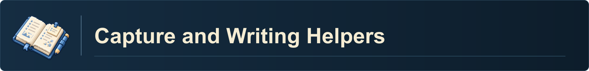

---
related:
  - "[[me]]"
created: 2026-01-01
updated: 2026-11-02
astoria_version: "1.1.0"
---
This is the active skill registry for the user's AI system. Every skill is a folder, `00 ASTORIA/skills/<name>/SKILL.md`, on the Agent Skills standard; the registry below is generated from the skills' frontmatter by `00 ASTORIA/skills/skills-janitor/scripts/build_views.py` and is never edited by hand. The full sortable table is the Base in [Skills](Skills.md).

> [!info] `me` (created during setup) | **[Skill Map](Skill%20Map.md)** | `00 ASTORIA/agent_notes/`

- `me` (created during setup) - `/me.md` - AI's briefing on who the user is and how to interact with the user.
- [Skill Map](Skill%20Map.md) - `/00 ASTORIA/Skill Map` - Active skills AI can use on the user's behalf.
- `00 ASTORIA/agent_notes/` - `layout.md`, where every kind of file goes; `ai_log.md`, the AI's running log.

# 🧭 Start Here

> [!abstract] 🧠 How the skills are organized
> Five components. `me.md` is read first every session; a companion owns the session and routes; a coordinator finds the skill; the skill does one bounded job; the user owns every scientific decision.
>
> | Component | Purpose |
> | --- | --- |
> | **Personal context** | Describes your preferences, goals, and working environment (`me.md`). |
> | **Companions** | The main skills you interact with for broader guidance and ongoing work. |
> | **Coordinators** | Help companions identify the appropriate specialized skills for a task. |
> | **Specialized skills** | Provide focused instructions for particular research methods, tools, or activities. |
> | **Writing profiles** | Guide expression and style during applicable writing tasks. |

<!-- systems:start -->
> [!example] 🗺️ Systems
> - 🏗️ [ASTORIA System Builder](#-astoria-system-builder): Set up and maintain the AI system.
> - ✍️ [Writing Style References](#-writing-style-references): Rule-only references for writing tasks.
> - 🤹 [Productivity and Study System](#-productivity-and-study-system): Map, study, and plan progress.
> - 🍎 [Teaching Assistant System](#-teaching-assistant-system): Prepare, teach, assess, and manage college courses.
> - 🗒️ [Capture and Writing Helpers](#-capture-and-writing-helpers): Capture and prepare material, then develop and review writing.
> - 🧹 [Janitor System](#-janitor-system): Maintain the vault and the AI system.
> - ⚙️ [Engineering System](#-engineering-system): Build, verify, and operate research hardware and inspect shipped software.
> - 🎓 [PhD and Career System](#-phd-and-career-system): Navigate degree requirements, mentoring, opportunities and career development.
> - 🧭 [Research Assistant System](#-research-assistant-system): Coordinate bounded capabilities across five parts of scientific inquiry, 1 to 5.
<!-- systems:end -->

# Skills grouped by System

<!-- registry:start -->
## 🏗️ ASTORIA System Builder

[ASTORIA System Builder](systems/ASTORIA%20System%20Builder.md): Set up and maintain the AI system.
- [astoria-updater](skills/astoria-updater/SKILL.md): Updates an existing ASTORIA vault from a separate starter release. Triggers: update my astoria, upgrade my astoria vault.
- [me-builder](skills/me-builder/SKILL.md): Creates or refreshes the user's root me.md. Triggers: build my me.md, refresh my me.md, update my preferences in me.md, who am I according to my vault.
- [paper-to-skill](skills/paper-to-skill/SKILL.md): Extracts source-grounded reusable content from one user-supplied paper or a small bounded paper set into a chat-only evidence pack for Skill Builder. Triggers: skill from this paper, extract a skill from these papers, turn this paper into a skill.
- [repo-to-skill](skills/repo-to-skill/SKILL.md): Extracts source-grounded reusable content from one exact repository state into a chat-only evidence pack for one candidate skill. Triggers: skill from this repo, extract a skill from this codebase, turn this repository into a skill.
- [setup-my-vault](skills/setup-my-vault/SKILL.md): One-time guided setup of a fresh ASTORIA vault. Triggers: set up my vault, get started with this vault, continue my setup, start the vault setup.
- [skill-builder](skills/skill-builder/SKILL.md): Creates one new skill folder in `00 ASTORIA/skills/<name>/` with a standard SKILL.md, the required frontmatter, a description under 1,000 characters with at most five triggers, and optional references, scripts, and assets, then regenerates the Skill Map and coordinator catalogs. Triggers: make a skill, create a new skill, draft a skill for this workflow, turn this into a skill.
- [skill-mount](skills/skill-mount/SKILL.md): Optionally mounts the vault's skills where an agent platform looks for them, keeping one copy in `00 ASTORIA/skills`. Triggers: mount my skills, remount the skills, make my skills show up in Codex, register my skills for Claude Science.
- [vault-builder](skills/vault-builder/SKILL.md): Builds or refreshes the layout reference `00 ASTORIA/agent_notes/layout.md`, the one page an agent checks before placing, naming, or moving a file. Triggers: build my layout reference, refresh the layout, map my folders for AI, map my templates for AI.
- [writing-style-builder](skills/writing-style-builder/SKILL.md): Creates or updates one passive writing-style reference directly from sources the user supplies. Triggers: build my writing style profile, update my writing style profile, calibrate my writing style from these samples.

---
## ✍️ Writing Style References

Rule-only references for writing tasks.
- [writing-style-negative-ai](skills/writing-style-negative-ai/SKILL.md) (profile): Optional editorial review for a recipient-selected audience, purpose and style specification.
- [writing-style-positive-scientific](skills/writing-style-positive-scientific/SKILL.md) (profile): Passive rule reference for precise, readable, construct-faithful scientific prose.

---
## 🤹 Productivity and Study System

[Productivity and Study System](systems/Productivity%20and%20Study%20System.md): Map, study, and plan progress.
- [study-companion](skills/study-companion/SKILL.md) (companion): Front door and coach for studying: takes each study request to the skill that owns it, coaches priorities, exam preparation, and how to study, and answers questions outside a study plan with the model's full knowledge and reasoning, not only the course sources. Triggers: help me study, explain this to me, coach me for this exam, what should I study next.
- [class-builder](skills/class-builder/SKILL.md): Creates or updates one class in the vault from a supplied syllabus, with focused setup questions, a course note, filed materials, and linked course navigation. Triggers: add this class, set up this course, organize this syllabus, update my course setup.
- [mindmap](skills/mindmap/SKILL.md): Creates and edits source-grounded visual mindmaps, handling organization and rendering with at most one brief missing-information checkpoint. Triggers: create a mind map of this, turn this into a mind map, update this mind map, show my mindmap atlas.
- [podcast-script-builder](skills/podcast-script-builder/SKILL.md): Converts supplied writing, papers, notes, slides or transcripts into a source-grounded podcast production packet. Triggers: turn this into a podcast script, make this a podcast episode, create a podcast production packet.
- [study-enricher](skills/study-enricher/SKILL.md): Takes one study concept beyond the course material: finds, checks, and packages deeper explanations, connections, applications, outside practice problems, checks of slide claims, and media such as figures it makes, images it finds, and checked YouTube videos. Triggers: go beyond the slides, what did the lecture leave out, find a video on this, show me a diagram of this.
- [study-planner](skills/study-planner/SKILL.md): Plans and teaches a selected course unit or multipart topic in three passes, overview, working understanding, and practice. Triggers: teach me this topic, break down this topic, show my study map, make a study plan.
- [study-quiz](skills/study-quiz/SKILL.md): Builds flashcard decks, quizzes and practice exams in the selected form, with optional Markdown and Anki exports, visual interpretation, answer keys and worked solutions grounded in the course's study plan and sources. Triggers: make flashcards for this, make me a practice quiz, build a practice exam.
- [woop-skill](skills/woop-skill/SKILL.md): Dynamic WOOP planning and coaching for meaningful goals. Triggers: make a WOOP, revise my WOOP, review my WOOPs, simplify my WOOP.

---
## 🍎 Teaching Assistant System

[Teaching Assistant System](systems/Teaching%20Assistant%20System.md): Prepare, teach, assess, and manage college courses.
- [teaching-companion](skills/teaching-companion/SKILL.md) (companion): Coordinates college teaching preparation and ongoing course responsibilities for instructors and TAs. Triggers: prepare my teaching week, help me run my class, what needs teaching attention.
- [teaching-coordinator](skills/teaching-coordinator/SKILL.md) (coordinator): Routes one bounded college-teaching task to its specialist and returns evidence, unresolved dependencies, and the completion condition to the invoking teaching companion.
- [teaching-assessment](skills/teaching-assessment/SKILL.md): Designs and reviews college assessments, answer keys, and proposed rubrics against instructor-approved sources and lectures. Triggers: review my exam questions, check my quiz answers, design a course assessment.
- [teaching-assistant-builder](skills/teaching-assistant-builder/SKILL.md): Creates or refreshes a college teaching area and one course offering from approved sources, preserving existing notes and resources. Triggers: set up a teaching course, import my teaching syllabus, organize my teaching classes.
- [teaching-grader](skills/teaching-grader/SKILL.md): Applies approved course and assignment grading criteria to submissions and reconciles proposed scores and feedback. Triggers: grade these course submissions, review these student scores.
- [teaching-lecture-review](skills/teaching-lecture-review/SKILL.md): Reviews college teaching materials for clarity, mechanical errors, and agreement with instructor-approved references. Triggers: check my lecture slides, review my teaching materials.
- [teaching-office-hours](skills/teaching-office-hours/SKILL.md): Triages teaching correspondence and drafts source-grounded student replies, announcements, and office-hours explanations. Triggers: draft a student reply, prepare a class announcement, triage my teaching email.
- [teaching-platform](skills/teaching-platform/SKILL.md): Inspects and performs authorized operations in the configured college course platforms, then verifies the affected student-facing outcome. Triggers: check my LMS setup, verify my course groups, update my course platform.

---
## 🗒️ Capture and Writing Helpers

### Capture, prepare, and notetake
- [capture-progress](skills/capture-progress/SKILL.md): Saves project progress in the owning MOC's Research Log and follows the chosen project-only or Calendar-indexed capture preference. Triggers: capture this progress, log this progress, capture this work session, capture this system change.
- [chat-handoff](skills/chat-handoff/SKILL.md): Prepares a source-bounded context packet for another explicitly named AI chat, or reviews material returned from that chat, while preserving the user's decisions, evidence boundaries, unresolved questions, and provenance. Triggers: prepare this for another chat, hand this off to another chat, review what the other chat returned.
- [quick-capture](skills/quick-capture/SKILL.md): Saves short text or chat excerpts in the owning MOC's Research Log and follows the chosen project-only or Calendar-indexed capture preference. Triggers: quick capture this, jot this down, add this to today's capture.
- [redactor](skills/redactor/SKILL.md): Creates multi-format redaction and de-identification candidates from exact user-named files, pasted content, or bounded batches. Triggers: redact this document, de-identify this, scan this for sensitive information, make a share-safe version.
- [summarize](skills/summarize/SKILL.md): Summarizes a supplied conversation, meeting, or transcript in the selected form, including a brief BLUF. Triggers: save this verbatim, keep this exchange word for word, summarize this conversation, summarize this meeting, give me a BLUF.
- [write-protocol](skills/write-protocol/SKILL.md): Curates established work into durable, user-reviewed protocols in selected MOC sections across projects. Triggers: turn this into a protocol, document this established process, update the project protocol, formalize these working steps.

### Writing assistance
- [writing-companion](skills/writing-companion/SKILL.md) (companion): Coordinates an expandable writing team around the author’s central argument, evidence, audience and selected structure. Triggers: coordinate my writing, assemble my writing team, help develop this document.
- [writing-coordinator](skills/writing-coordinator/SKILL.md) (coordinator): Internally assigns, collects and integrates bounded writing specialists and independent reviews while preserving the invoking companion and technical owners.
- [check-research-reporting](skills/check-research-reporting/SKILL.md): Audits a bounded research document against the applicable current reporting guideline and identifies missing or ambiguous disclosures. Triggers: audit research reporting completeness, check required method disclosures.
- [check-writing-cerl](skills/check-writing-cerl/SKILL.md): Independently checks the relationships among a passage's claim, evidence, reasoning and link to the central argument using CERL and MEAL. Triggers: check the CERL links, review paragraph MEAL.
- [check-writing-substance](skills/check-writing-substance/SKILL.md): Independently checks writing for specific content, source traceability, unsupported additions, construct drift and claims that exceed available evidence. Triggers: find empty fluent prose, check writing specificity.
- [develop-writing-evidence](skills/develop-writing-evidence/SKILL.md): Builds a source-bounded evidence and reasoning plan for a specified writing claim. Triggers: build evidence for this paragraph, explain this evidence link.
- [integrate-writing](skills/integrate-writing/SKILL.md): Integrates bounded section drafts into one coherent document while preserving argument, scientific meaning, terminology and authorial voice. Triggers: integrate these section drafts, reconcile document wording.
- [keep-writing-structure](skills/keep-writing-structure/SKILL.md): Preserves the selected document template, required section functions and structural constraints while identifying drift. Triggers: keep this document on template, check section structure drift.
- [organize-writing-project](skills/organize-writing-project/SKILL.md): Keeps each document or application section tied to its purpose, current draft, owner, dependencies and next action in the existing project context. Triggers: organize this writing project, track every application section.
- [plan-writing-argument](skills/plan-writing-argument/SKILL.md): Develops a document argument from the central claim through section purposes and paragraph reasoning. Triggers: map the argument for this, connect paragraphs to my thesis.
- [translate-specialist-methods](skills/translate-specialist-methods/SKILL.md): Translates source-backed specialist procedures, configurations and technical reasoning into accurate material for a methods writer. Triggers: translate specialist records into methods, explain these technical methods for readers.
- [verify-writing-citations](skills/verify-writing-citations/SKILL.md): Verifies citation identities, bibliographic metadata and whether an accessible source supports the exact proposition attached to it. Triggers: verify these citations, check this bibliography.
- [write-abstract](skills/write-abstract/SKILL.md): Drafts or revises a self-contained abstract from the current document and verified evidence, preserving the distinction between proposed and completed work. Triggers: prepare abstract text, condense this study summary.
- [write-conclusion](skills/write-conclusion/SKILL.md): Drafts or revises a Conclusion that carries forward the established answer, contribution, and earned significance. Triggers: draft concluding paragraph, revise the take-home message.
- [write-discussion](skills/write-discussion/SKILL.md): Drafts or revises a Discussion around a user-owned interpretation, its relation to evidence and prior work, and its bounded significance. Triggers: draft discussion interpretation, revise discussion argument.
- [write-figure-table-text](skills/write-figure-table-text/SKILL.md): Drafts or revises figure legends, table notes, and associated display text from the actual artifact and analysis definitions. Triggers: draft figure captions, write table notes.
- [write-introduction](skills/write-introduction/SKILL.md): Drafts or revises an introduction that connects a supported problem and gap to the actual question, rationale, and contribution. Triggers: draft an introduction, revise introduction rationale.
- [write-methods](skills/write-methods/SKILL.md): Drafts or revises Methods from verified procedures, configurations, and domain-specialist returns, preserving execution and review status. Triggers: draft the methods, describe these procedures.
- [write-results](skills/write-results/SKILL.md): Drafts or revises Results from actual analysis outputs, linking each result to its question while preserving estimates, uncertainty, and analysis status. Triggers: draft results prose, narrate these analysis outputs.
- [write-section](skills/write-section/SKILL.md): Drafts or revises one explicitly bounded custom section from its purpose, supplied evidence, and applicable template or requirements. Triggers: draft a custom section, write a training narrative.
- [write-title](skills/write-title/SKILL.md): Drafts or revises accurate titles from an established subject, contribution, and audience. Triggers: suggest manuscript titles, revise a research title.

---
## 🧹 Janitor System

[Janitor System](systems/Janitor%20System.md): Maintain the vault and the AI system.
- [bridge-maker](skills/bridge-maker/SKILL.md): Creates or updates only the requested project AGENTS.md, pointing to the user's single authoritative vault-root me.md and keeping necessary supplied project instructions. Triggers: make a project bridge, connect this project to obsidian, audit the project bridges, update this project AGENTS.md.
- [folder-janitor](skills/folder-janitor/SKILL.md): Organizes the requested content folders outside the AI system root using the owner’s verified structure and approved placements. Triggers: organize this folder, sort my resource intake, tidy my area folders, file these attachments.
- [propagate](skills/propagate/SKILL.md): Carries one change through everything that depends on it. Triggers: propagate this rename, I renamed this, propagate this convention, make the family match, update every reference to.
- [skills-janitor](skills/skills-janitor/SKILL.md): Audits every skill folder in `00 ASTORIA/skills/` against the skill-builder schema and regenerates the views. Triggers: audit my skills, are my skills in sync, rebuild the skill map, check for trigger overlaps, skill drift.
- [vault-janitor](skills/vault-janitor/SKILL.md): Checks vault consistency: the layout reference against the folder tree and vocabulary, rules against me.md, active instructions for stale paths and wording, and wiki-links vault-wide. Triggers: audit the layout, are my folders and templates in sync, check for folder drift, check log preservation, clean up the agent notes.

---
## ⚙️ Engineering System

[Engineering System](systems/Engineering%20System.md): Build, verify, and operate research hardware and inspect shipped software.
- [engineering-companion](skills/engineering-companion/SKILL.md) (companion): Owns engineering sessions and routes substantive technical questions through skill-loaded specialist teams. Triggers: help me engineer this, plan this device project, review this hardware project, help me reverse engineer hardware, start this engineering project.
- [engineering-coordinator](skills/engineering-coordinator/SKILL.md) (coordinator): Routes engineering questions to skill-loaded specialist workers in the current project and returns their evidence to Engineering Companion.
- [3d-builder](skills/3d-builder/SKILL.md): Creates editable mechanical models and assembly scenes with matching step renders using parametric CAD and Blender. Triggers: model this part, make an exploded view, render these assembly steps, prepare this model for printing.
- [assembly-builder](skills/assembly-builder/SKILL.md): Guides complete device assembly from documented parts through mechanical, electrical and software integration, coordinating the needed engineering specialists. Triggers: assemble this device, walk me through assembly, continue this hardware build, connect these components.
- [circuit-builder](skills/circuit-builder/SKILL.md): Guides a beginner through building and checking a circuit board from a verified wiring plan: how to read the board and the drawing, a parts and tools table, hole-by-hole steps naming each contact's device and purpose, and a generated continuity and power-up test table; runs the engineer's verification gates (design, before the first joint, before power, staged power-up) as fault finding with corrections. Triggers: walk me through soldering this, help me build this board, check my wiring before power, is my circuit wired correctly, guide me through this PCB build.
- [circuit-design](skills/circuit-design/SKILL.md): Designs and analyzes the electrical plan for a device. Triggers: design this electronics circuit, select electrical replacement parts, analyze this power circuit.
- [engineering-test](skills/engineering-test/SKILL.md): Plans and evaluates tests of engineering claims across a complete device. Triggers: plan this device verification, test this hardware claim, review engineering test coverage.
- [firmware-control](skills/firmware-control/SKILL.md): Implements device firmware and its control and communication behavior. Triggers: implement this device controller, write this hardware driver, debug this embedded protocol.
- [fit-review](skills/fit-review/SKILL.md): Independently reviews assembly fit, service access, routing and motion against source geometry. Triggers: review whole assembly fit, find motion and access conflicts, check this packaging arrangement.
- [mechanism-design](skills/mechanism-design/SKILL.md): Analyzes mechanical operating principles and develops bounded mechanism concepts. Triggers: compare mechanical transmissions, size this actuator mechanism, explain how this mechanism moves.
- [rea](skills/rea/SKILL.md): Inspects shipped software through a local REA executable and explains features from static evidence. Triggers: inspect this packaged application, trace a shipped app feature, analyze an Electron package.
- [sensing-calibration](skills/sensing-calibration/SKILL.md): Defines and verifies the conversion from hardware measurements to useful quantities. Triggers: calibrate this hardware sensor, define this measurement conversion, assess sensor accuracy.
- [wiring-design](skills/wiring-design/SKILL.md): Designs the physical wiring that implements an electrical plan. Triggers: design this cable harness, map these connector contacts, plan moving cable routes.

---
## 🎓 PhD and Career System

[PhD and Career System](systems/PhD%20and%20Career%20System.md): Navigate degree requirements, mentoring, opportunities and career development.
- [phd-companion](skills/phd-companion/SKILL.md) (companion): Owns PhD, academic mentoring and career conversations and assembles relevant specialist support through the internal PhD Coordinator. Triggers: help me with my PhD career, mentor me through this PhD decision, prepare for an advisor conversation, plan my postdoc strategy, authorship question.
- [phd-coordinator](skills/phd-coordinator/SKILL.md) (coordinator): Internally selects, assigns and collects situation-dependent PhD and career specialist work.
- [phd-career-advisor](skills/phd-career-advisor/SKILL.md): Compares bounded career choices and coordinates the requested evidence-based application package. Triggers: compare my career pathways, plan my postdoc applications.
- [phd-career-builder](skills/phd-career-builder/SKILL.md): Sets up or refreshes compact PhD and career support settings in the user's existing chosen MOC from current context, official sources and useful grouped questions for the requested supports. Triggers: set up my PhD support, configure my career support.
- [phd-meeting-advisor](skills/phd-meeting-advisor/SKILL.md): Prepares a PhD meeting agenda, decision questions, rehearsal and a source-bounded debrief. Triggers: prepare my committee agenda, rehearse this mentoring meeting.
- [phd-networking-advisor](skills/phd-networking-advisor/SKILL.md): Plans a bounded professional introduction, sponsorship request or conference networking interaction. Triggers: plan my conference introductions, prepare a sponsorship request.
- [phd-opportunity-scout](skills/phd-opportunity-scout/SKILL.md): Discovers exact career and funding opportunities, screens their current eligibility and manages bounded watch or deadline checks from local settings. Triggers: find eligible career opportunities, watch funding and postdoc openings, review opportunity deadlines.
- [phd-program-navigator](skills/phd-program-navigator/SKILL.md): Reconciles the user's applicable cohort requirements with current official program sources and evidence of completed work. Triggers: check my degree requirements, reconcile my program milestones.
- [public-speaking-coach](skills/public-speaking-coach/SKILL.md): Rehearses a supplied talk, concise explanation or question-and-answer exchange for a stated audience and time. Triggers: rehearse my conference talk, practice my poster pitch.
- [research-cv-builder](skills/research-cv-builder/SKILL.md): Career-document adviser for evaluating, critiquing, building, and tailoring archival CVs, research CVs, evidence ledgers, application-specific CVs, and concise scientific research resumes for scientific, academic, biomedical, government, nonprofit, or industry research roles. Triggers: build my research CV, tailor my CV for this application, critique my resume.
- [research-presentation-builder](skills/research-presentation-builder/SKILL.md): Builds or revises a research poster or slide deck from established scientific content in the requested editable format. Triggers: assemble my conference slides, lay out my research poster.

---
## 🧭 Research Assistant System

[Research Assistant System](systems/Research%20Assistant%20System.md): Coordinate bounded capabilities across five parts of scientific inquiry, 1 to 5.

- [Companions and coordination](#companions-and-coordination)
- [1. Help me scout the field](#1-help-me-scout-the-field)
- [2. Help me challenge my question](#2-help-me-challenge-my-question)
- [3. Help me stress-test my hypothesis and design](#3-help-me-stress-test-my-hypothesis-and-design)
- [4. Help me analyze the data](#4-help-me-analyze-the-data)
- [5. Help me finish, share, and publish research](#5-help-me-finish-share-and-publish-research)

### Companions and coordination
The public research entry point and its internal research-coordinator. Research Companion stays the visible session owner; research-coordinator verifies bounded assignments through the five part coordinators below (1 to 5, in any order) or an exact named capability, dispatches the needed research workers, and returns their evidence to the companion. PhD and career support has its own system; shared services preserve the original owner and task scope.
- [research-companion](skills/research-companion/SKILL.md) (companion): Research companion across all five parts of inquiry, for strategic framing, option comparison, project triage, manuscript strategy and research-session startup, resume or status. Triggers: start a research session, resume this research project, where are we in this project, compare these research directions, critique my study strategy.
- [research-coordinator](skills/research-coordinator/SKILL.md) (coordinator; internal, no triggers): Dispatches bounded research work to exact skill-loaded workers and returns their evidence to Research Companion.

### 1. Help me scout the field
- [scout-coordinator](skills/scout-coordinator/SKILL.md) (part coordinator, read first): Part 1 coordinator, help me scout the field. Triggers: help me find papers on this, summarize what the literature says, what do we know about this topic.

#### Literature discovery and synthesis
- [first-principles-research](skills/first-principles-research/SKILL.md): Explores research questions, studies, and methods by reconstructing their first principles and mathematical structure. Triggers: reason through first principles, deconstruct this study mathematically, find cross-field mathematical connections, scan all ten frameworks, explore my research from fundamentals.
- [literature-synthesis](skills/literature-synthesis/SKILL.md): Builds one bounded critical theory synthesis from supplied sources or an explicitly approved literature search. Triggers: synthesize these papers, build a theory synthesis from these sources.
- [paper-search](skills/paper-search/SKILL.md): Runs one researcher-directed scholarly discovery task through a short Search Direction and one upfront approval, then searches the approved public, institutional, browser-assisted, and user-provided routes within a stated budget. Triggers: search the literature for, find papers on this topic.
- [research-summarizer](skills/research-summarizer/SKILL.md): Explains one or more bounded research papers through a separate source-verified seven-part summary for each paper, covering plain-language and expert explanations, statistical methods and results, key findings, strengths, weaknesses, and discussion questions. Triggers: summarize this paper, explain this study to me, what does this paper claim.

### 2. Help me challenge my question
- [challenge-coordinator](skills/challenge-coordinator/SKILL.md) (part coordinator, read first): Part 2 coordinator, help me challenge my question. Triggers: is my research question worth asking, brainstorm directions for this question, check this claim against the evidence, critique this study.

#### Question, claim, and study critique
- [research-critique](skills/research-critique/SKILL.md): Critiques one bounded research object through a rapid blind-spot scan, targeted critique, or full scientific critique. Triggers: critique this paper, find the blind spots in this design, full scientific critique.
- [research-literacy](skills/research-literacy/SKILL.md): Audits one explicit research claim and its directly linked subclaims against supplied and bounded verified evidence. Triggers: audit this claim against the evidence, does the evidence support this claim.
- [scientific-brainstorming](skills/scientific-brainstorming/SKILL.md): Runs bounded scientific divergence from a user-supplied seed, using ideation heuristics when useful. Triggers: brainstorm scientific directions, divergent ideas from this seed.

### 3. Help me stress-test my hypothesis and design
- [stress-test-coordinator](skills/stress-test-coordinator/SKILL.md) (part coordinator, read first): Part 3 coordinator, help me stress-test my hypothesis and design. Triggers: stress test my hypothesis, design my experiment, is my sample big enough, which dataset can support this study, set up my data in BIDS.

#### Hypothesis and prediction stress testing
- [prediction-stress-test](skills/prediction-stress-test/SKILL.md): Prospectively stress-tests one exact user-supplied or explicitly adopted hypothesis and one primary prediction for testability, discriminability, counterexamples, boundary conditions, outcome implications, and bounded novelty evidence. Triggers: is this prediction testable, stress test this prediction.

#### Experimental, paradigm, and assessment design
- [experimental-design](skills/experimental-design/SKILL.md): Compares prospective experimental-design structures for one bounded user-supplied research question, hypothesis, or prediction and constraint set. Triggers: compare experimental designs for this question, which design fits my hypothesis.
- [method-design](skills/method-design/SKILL.md): Compares and specifies prospective computational method architectures for one user-supplied scientific objective and approved evaluation boundary. Triggers: design a computational method for this objective, compare method architectures.

#### Power and sample size
- [statistical-power](skills/statistical-power/SKILL.md): Quantifies prospective sample-size, power, minimum-detectable-effect, and operating-characteristic scenarios for one approved design and analysis specification. Triggers: power analysis for this design, how many participants do I need.

### 4. Help me analyze the data
- [analysis-coordinator](skills/analysis-coordinator/SKILL.md) (part coordinator, read first): Part 4 coordinator, help me analyze the data. Triggers: analyze my data, which analysis method fits this, preprocess my imaging data, run this analysis in, help me pick a statistical model.

#### Analysis procedures
- [exploratory-data-analysis](skills/exploratory-data-analysis/SKILL.md): Performs one approval-gated descriptive inspection of a bounded research dataset and returns an inspectable Data Structure and Quality Record. Triggers: inspect this dataset descriptively, data quality and structure check.
- [statistical-analysis](skills/statistical-analysis/SKILL.md): Plans, executes, and verifies one approved statistical analysis through an already available and pinned implementation. Triggers: run this statistical analysis, execute the approved analysis plan.

### 5. Help me finish, share, and publish research
- [research-output-coordinator](skills/research-output-coordinator/SKILL.md) (part coordinator, read first): Routes bounded publication, research-output verification, reproducibility, releases, engagement, closeout and selected funding requirements. Triggers: write up my results, help me report this study, prepare my reproducibility statement, funding application help, finish and share this research.

#### Funding and application support
- [research-grant-advisor](skills/research-grant-advisor/SKILL.md): Advises on requirements, planning, budgeting, review and preparation of one user-selected research funding application, borrowing shared writers for prose. Triggers: review this grant proposal, help me plan a grant application, check the funding announcement requirements.

#### Research support
- [close-research-project](skills/close-research-project/SKILL.md): Prepares closeout, preservation and handover for one bounded research project, connecting outstanding obligations, authoritative materials, retention, access and responsibility. Triggers: prepare this research project handover, plan research project preservation.
- [coordinate-peer-review](skills/coordinate-peer-review/SKILL.md): Maps editor and reviewer requests to user decisions, required work, revised locations and responses for one manuscript decision. Triggers: map these reviewer requests, organize this resubmission response.
- [maintain-publication-record](skills/maintain-publication-record/SKILL.md): Checks proofs and publication details against authoritative versions and maintains identifiers, related-output links and documented corrections. Triggers: check these publication proofs, reconcile publication versions.
- [plan-publication](skills/plan-publication/SKILL.md): Compares publication venues and verifies the current requirements for one selected journal, article type and stage. Triggers: compare journals for this paper, check this journal's instructions.
- [plan-research-engagement](skills/plan-research-engagement/SKILL.md): Plans and evaluates dissemination or reciprocal community engagement around supported research findings, audience purposes, channels, timing and feedback. Triggers: plan dissemination of these findings, evaluate this research engagement.
- [prepare-publication-package](skills/prepare-publication-package/SKILL.md): Assembles the required files, declarations, metadata and availability statements for one selected publication stage. Triggers: assemble this journal submission, check these submission files.
- [prepare-research-release](skills/prepare-research-release/SKILL.md): Prepares one data, code or combined research release through repository selection, compendium assembly and deposit preparation modes. Triggers: assemble a research release, choose a repository for these materials.
- [review-figures-tables](skills/review-figures-tables/SKILL.md): Reviews finished research figures and tables for APA presentation, readability and unnecessary complexity, returning practical corrections to their builders. Triggers: check APA display formatting, review figure and table readability, simplify these research displays.
- [verify-computational-reproducibility](skills/verify-computational-reproducibility/SKILL.md): Tests whether specified research outputs regenerate from recorded inputs, code, configuration and environment through the existing technical owners. Triggers: test whether these results regenerate, reproduce these reported outputs.
- [verify-repository-release](skills/verify-repository-release/SKILL.md): Checks an exact repository release against the intended files, versions, identifiers, metadata, access settings and related-output links. Triggers: inspect this deposited research version, check repository release metadata.
- [verify-research-outputs](skills/verify-research-outputs/SKILL.md): Traces reported numbers, figures, tables and files to identified analysis outputs and provenance, identifying inconsistencies and version mismatches. Triggers: trace these reported results, check manuscript output consistency.
<!-- registry:end -->
