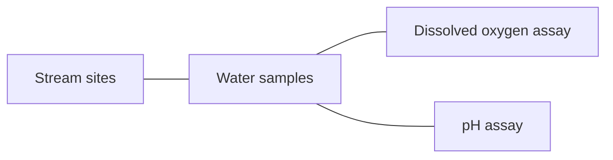
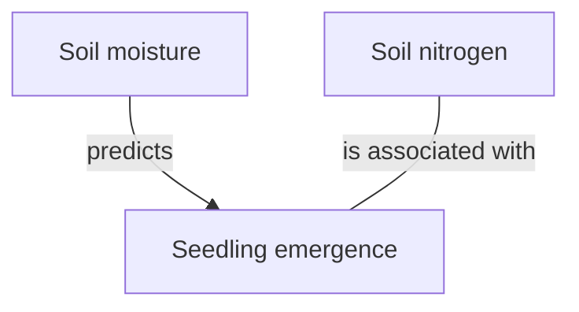

# Figure playbook

Read this before building the first figure of a summary. `SKILL.md` decides whether a part gets a figure, what kind, and how it is tagged; this file says how to build one so that it renders and stays true to the paper.

Contents:

1. Choosing the medium
2. Mermaid diagrams
3. LaTeX equations
4. Tables
5. Schematics and breakdowns of dense figures
6. Plots and PNG files
7. Naming and saving a PNG
8. Verification list

## 1. Choosing the medium

| Content | Medium |
| --- | --- |
| Reported numbers: estimates, intervals, test statistics, p values, counts, sample sizes | Present the exact reported values in the selected form. Use a table when it helps. |
| A model, estimator, or contrast the paper states | One `$$` display block per formula |
| A design, its arms or phases, a pipeline, a model's logic, a confound path | Mermaid flowchart |
| A stimulus or spatial layout | A table of the elements and positions the paper states, or a Mermaid flowchart of the sequence; never a drawing with guessed geometry |
| Many reported values whose pattern is the claim, or a forest plot | Present the exact reported values in the requested form, then under the applicable verified recipient or project policy. If neither specifies a form, return them in the current session. Use a table when helpful. An eligible PNG may be saved only when the PNG file is authorized under section 6. |

Never hand-author a data plot in SVG, ASCII art, or Mermaid. A plot of values comes only from the recipe in section 6.

## 2. Mermaid diagrams

Obsidian renders Mermaid in reading view. Assume no Mermaid validator is available: follow these rules exactly and read every block back once.

- `flowchart LR` or `flowchart TD` only. No sequence, gantt, timeline, mindmap, class, or state diagrams.
- Every node label sits in double quotes inside its brackets: `g1["Group A (n = 20)"]`. Parentheses, colons, brackets, and semicolons inside an unquoted label break the parser.
- Node ids are short ASCII words without spaces, never `end`.
- About twelve nodes at most. Split a larger design into two blocks or move detail into the caption.
- An edge is undirected (`---`) unless the paper states the direction in its text, legend, or own figure. A directed edge (`-->`) carries the paper's verb as its label, and only a verb that itself states direction (predicts, precedes, causes, increases, reduces): `a -->|"predicts"| b`. A symmetric verb (correlates with, is associated with, differs from) takes an undirected edge with that verb as its label. No mediation or moderation path unless the paper names it.
- At most one level of `subgraph`; no `click`, `style`, `classDef`, or link directives.
- One diagram per block; a blank line before and after the fence.

A hypothetical design with connected elements and no stated direction:



A hypothetical model with a directional prediction and a symmetric association:



Leave moisture and nitrogen unconnected when the source does not state a relationship between them.

## 3. LaTeX equations

- One `$$ ... $$` display block per formula, with the delimiters on their own lines. A single symbol or plain arithmetic may stay inline in the text.
- LaTeX commands, not Unicode symbol strings: `\beta`, `\sum`, `x_{ij}`, never `β`, `∑`, or subscript characters.
- Under the block, define every symbol in one line each, in the paper's terms and with the paper's variable names.
- Write only a model the paper states in symbols, as a worked computation, or in words that name its outcome, every term, and its functional form. Never the textbook form of a named test or of a model named only by its label. An equation built from the authors' words carries the tag `formalized from the authors' description`, with the symbol list citing the passage that names each term.
- No formula inside a table cell.

Example, for a paper whose Methods name reaction time as the outcome, a fixed effect of condition, a random intercept per participant, and a residual:

$$
RT_{ij} = \beta_0 + \beta_1\,\text{Condition}_{ij} + u_{0j} + \varepsilon_{ij}
$$

where $RT_{ij}$ is the reaction time on trial $i$ for participant $j$, $\text{Condition}_{ij}$ the condition code the paper names, $u_{0j}$ the participant intercept, and $\varepsilon_{ij}$ the residual.

## 4. Tables

- About five columns and about eight rows. Name the paper's table for the rows left out.
- In a results, measures, or breakdown table a cell holds a reported value or `Not reported in the provided material`; a table with more `Not reported` cells than reported cells is dropped and the gap stated in prose. A column the paper never reports anywhere (for example estimates when only test statistics and effect sizes are given) is omitted and the caption says so. In a Part 4 to 7 table the paper-citing columns hold a short paraphrase or a section reference, and every assessment column is headed as this skill's or the authors'.
- Escape a literal pipe as `\|` and a literal dollar sign as `\$`. Write an absolute value in words or as `|d|` only outside math.
- A results row carries the estimate with its unit, its interval or standard error, the test statistic with its degrees of freedom, the p value with the correction the paper names (`uncorrected` when the paper says so, `correction not reported` otherwise), and the n the paper gives for that analysis, as reported. A p value with only a test name, or a threshold such as `p < .05` with no statistic, is not a row; it stays in prose as a reporting gap.
- Use a table only when it fits the selected delivery. Present the Part 4 finding, interpretation and implication once. For Part 6 gaps, keep the claim, reported evidence and assessment distinct in the selected representation.
- No formula, Mermaid, or embed inside a cell.

## 5. Schematics and breakdowns of dense figures

- A schematic shows only the groups, conditions, time points, measures, and relations the paper states. A step the paper implies but never names is left out and the caption says so.
- A timeline shows order only, and left-to-right or top-to-bottom reads as the paper's order; when the paper counterbalances or randomizes an order, put those items in one subgraph with no edges between them and say so in the caption. A duration, count, dose, or interval appears only when the paper reports it, cited by passage.
- A stimulus or arena layout without reported dimensions is not drawn; list its stated elements in a table.
- To break down a dense paper figure: one block, up to three labeled panels (a, b, c) as subgraphs of one Mermaid flowchart or as one table with a `Panel` column, one panel per factor or contrast the paper itself reports, one caption, and the tag `paper Figure N, simplified; dropped: <list>`. Rebuild each panel from the paper's text and tables; a value or relation that appears only in the image is not reproduced, and the caption says the original holds more. Never trace, crop, or copy the image.
- A Part 6 confound sketch is this skill's reading of the design: tag it `illustrative, not the paper's data` and say so in the caption.

## 6. Plots and PNG files

Make a PNG only when its save is authorized and the Part 3 row in `SKILL.md` allows the plot. A forest plot requires an estimate and reported interval on every row. An interaction plot requires six or more reported values. Keep those same values in the requested form, then under the applicable verified recipient or project policy if the request leaves the form open. When neither specifies a form, return the values in the current session. Use a table when helpful.

1. Detect a runtime with `python3 -c "import matplotlib"`. If that fails, use an interpreter the user names in this session. If none is available, return the same reported values under the form rules above and state the plotting limitation once. Never write a machine path into this skill.
2. Write the values to a small JSON file in the scratchpad, copied from the paper's reported values. For a forest plot: label, estimate, lower, upper per row, where lower and upper are the paper's reported interval bounds and every row is in one measure and unit; a bound computed from a standard error is a derived interval and is not plotted. For an interaction: the factor levels and the reported cell means, with one kind of reported variability (SD, SE, or CI) on every mean or on none. Every row complete, or the plot is not made.
3. Run a short script in the scratchpad. White opaque background, axis labels in the paper's units, the null line at the measure's null value (0 for a difference, 1 for a ratio) with a log axis for a ratio, error bars only from reported variability, no title inside the image (the label line carries it), `dpi=200`, about six inches wide.
4. Save and verify the PNG under section 7. Add and verify its embed only when a note edit is also authorized.

Script skeleton, with the choices at the top:

```python
# Forest plot of reported estimates. Inputs: values.json written from the paper.
import json
import matplotlib
matplotlib.use("Agg")
import matplotlib.pyplot as plt

VALUES_PATH = "values.json"          # rows of {"label", "estimate", "lower", "upper"}
OUTPUT_PATH = "author_year_fig_3_1.png"
UNIT_LABEL = "Effect size (d)"       # the paper's unit
NULL_VALUE = 0                       # 0 for a difference or standardized effect; 1 for an odds, risk, or hazard ratio
LOG_SCALE = False                    # True for a ratio measure

rows = json.load(open(VALUES_PATH))
for row in rows:
    assert all(key in row for key in ("label", "estimate", "lower", "upper")), row

figure, axis = plt.subplots(figsize=(6, 0.5 * len(rows) + 1), facecolor="white")
positions = list(range(len(rows)))[::-1]
for position, row in zip(positions, rows):
    axis.plot([row["lower"], row["upper"]], [position, position], color="black")
    axis.plot(row["estimate"], position, marker="o", color="black")
axis.axvline(NULL_VALUE, color="grey", linewidth=0.8)
if LOG_SCALE:
    axis.set_xscale("log")
axis.set_yticks(positions)
axis.set_yticklabels([row["label"] for row in rows])
axis.set_xlabel(UNIT_LABEL)
figure.tight_layout()
figure.savefig(OUTPUT_PATH, dpi=200, facecolor="white")
```

## 7. Naming and saving a PNG

- For an authorized PNG, use the verified eligible filename selected for the task. If the name is open, follow the applicable verified naming convention. With neither specified, use `<first_author>_<year>_fig_<part>_<n>.png` with the surname in lowercase ASCII. Add a short title slug to fallback names when the author and year repeat in one run.
- For an authorized PNG, use the verified selected destination, then the applicable verified placement convention. When placement remains open, resolve the verified owner location for the saved note. Preserve an established operational location and ask once if the destination is unresolved.
- Before writing, check for a filename collision at the exact destination. Search wider for basename ambiguity only if the selected supported embed syntax requires it and the necessary read scope is authorized. Preserve unrelated files. On a collision, use a versioned name such as `_v2` only within the authorized naming scope. If a fixed selected name conflicts, resolve the name with the user before writing.
- Add and verify the PNG reference only when a note edit is also authorized. Use standard image syntax unless the task or applicable policy selects Obsidian syntax. Use a verified note-relative target for Markdown or a verified vault-relative target for a supported Obsidian embed.
- Scratch files stay outside the vault.
- Verify the saved file exists at its exact stated path. For an authorized Markdown image, percent-decode the target once and resolve it from the saved report's directory to confirm it identifies that exact PNG. For an authorized Obsidian embed, verify the full vault-relative target. In another supported form, verify the inserted image against that PNG. Check the selected surface when available and disclose any unverified rendering. Avoid claiming that other devices already show the file.

## 8. Verification list

- Code fences and `$$` pairs balanced; Mermaid labels quoted; no node named `end`; flowchart syntax only.
- Every `Values:` tag matches one of the six forms in `SKILL.md` with each placeholder filled; on a Part 4 to 7 table every assessment column is headed as this skill's or the authors'; no row holds a p value without its test statistic; no value was read off a plot.
- Every number re-read against the named table, figure, or passage; every derived number recomputed.
- Every arrow direction and edge label traces to a stated claim.
- No formula in a table cell; pipes and dollar signs escaped.
- The figure count matches the setting and the caps; `off` output has no figure.
- For a saved PNG, verify its exact path. When an embed was authorized and added, apply the exact target and rendering checks for the supported selected form in section 7.
