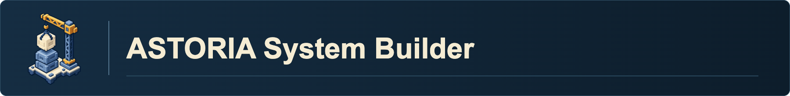

---
related:
  - "[[Productivity and Study System]]"
  - "[[Janitor System]]"
  - "[[Research Assistant System]]"
created: 2026-01-01
updated: 2026-11-02
---

Welcome to the **🏗️ ASTORIA System Builder.**

This system helps you set up the vault, write your working instructions, and maintain its reusable skills. The important files have different jobs:

| File or note | Its job |
| --- | --- |
| Root `AGENTS.md` | The assistant's starting instructions: where to read your briefing and find the relevant workflow. |
| `me` (created during setup) | Your preferences, current work, and rules for the assistant. |
| [Skill Map](../Skill%20Map.md) | The directory of available skills. |
| A project or Area MOC | A home note with context and links to that work. |
| `00 ASTORIA/agent_notes/` | The generated layout reference and the AI's system-maintenance log. |

Builders create or refresh the files they own. Janitors check the matching files for drift. Setup brings those steps together in one conversation.

## Set up my vault

Open the new download in your assistant and say **"Set up my vault."**
You can use the same command from a working vault that already has this
setup flow. Choose **first-time setup** or **update an existing vault**
when asked. For first-time setup, the assistant shows a short PARA example
before you choose your folder structure.

If you choose to update, Setup My Vault hands off to
[ASTORIA Updater](../skills/astoria-updater/SKILL.md) in the same chat.

- **Opened the new download?** Tell the assistant which working vault to update.
- **Opened your working vault?** Point the assistant to the new ZIP or extracted
  folder. You can leave the download in Downloads.

The assistant identifies the version in `00 ASTORIA/version.json` when
present and shows both folders before previewing changes. The downloaded
package supplies the update and the existing vault receives the approved
changes. The preview shows which shipped files can change and where local
edits need a decision. Keep your working vault's notes, themes, settings,
and custom skills. You can keep Obsidian open on that vault throughout.

After the update, Skills Janitor, Vault Janitor and Folder Janitor audit the
working vault automatically. The assistant shows any proposed repairs and asks
approval before applying them. It then rechecks the update and runs a second
janitor audit, with approval before any further repairs.

---

## PARA in the vault

- **Projects** have a defined outcome and deadline or finish point, such as a research report or a grant submission.
- **Areas** are responsibilities maintained over time, such as teaching or degree administration.
- **Resources** are reusable references organized by topic, such as statistics guides, papers, or coding notes.
- **Archive** holds inactive material from the other categories for future reference and provenance.

For example, completing a survey pilot is a Project, ongoing team onboarding
is an Area, survey design references go in Resources, and a completed pilot
goes in Archive. Use examples suited to the work the user describes when
explaining how to choose a layout.

Each Project or Area has one MOC and one `AGENTS.md`. Use one top-level `files/` folder for local working material. A documented external workspace satisfies the working-files requirement. Folder Janitor reports missing entries and can offer to set them up on request. Keep useful subfolders and established operational layouts. Resources uses its own topic structure and generally stays outside routine folder cleanup.

[Todoist's PARA guide](https://www.todoist.com/productivity-methods/para-method)

One conversation sets up a new vault:

- The downloaded package contains `00 ASTORIA/`, a repository README, `LICENSE`, a draft `AGENTS.md` and Git exclusions. Obsidian creates its settings when you open the vault. Give a file-aware assistant access to the vault root and ask it to start **Setup My Vault** in the **ASTORIA System Builder**. The draft root `AGENTS.md` directs the assistant to the guided setup, where you choose your working folders and create your personal `me.md` briefing.
- **setup-my-vault** owns that conversation: orientation and capability check, researcher interview, first read-back and `me.md`, structure and optional-toolkit choices, second read-back, then the core build. Scripted building uses Python and PyYAML with the YAML vocabulary. The manual core path is available without them when the toolkit state check passes and it can carry out the approved setup plan. The core build creates folders, installs the selected toolkit or keeps core skills only, writes layout and AI log, performs the applicable checks, writes the full `AGENTS.md` loader, and retains the root README as the participant guide. The vault is then set up and usable without mounts.
- **Native discovery is optional after completion.** Only when the user chooses it, skill-mount adds native picker and trigger integration. Skipping it or encountering a mounting problem does not invalidate core setup. The skill files remain in the vault and `AGENTS.md` routing still works.
- If setup is interrupted, use the files to identify completed work and recover the exact Stage 3 plan and its approval before resuming the first unfinished build step. A draft root `AGENTS.md` indicates setup is pending. A pending toolkit install uses its prior approved apply command and options through verified recovery. Fresh toolkit listing and preview belong to a new plan. Before manual writes on resume, verify the toolkit state and confirm the recovered approval fits the manual build. If it cannot be carried out, leave setup pending until the original runtime is available or the user approves the affected changes through the existing Stage 3 read-back.

The builders, one per core file, and their janitors:

- [me-builder](../skills/me-builder/SKILL.md) writes `me.md`: from the setup interview and `assets/me_template.md` on a fresh vault, and from direct corrections afterwards (the smallest matching update, no repeated interview). Its check is the read-back.
- [vault-builder](../skills/vault-builder/SKILL.md) writes `00 ASTORIA/agent_notes/layout.md` by running `scripts/build_layout.py`: the folder table, file kinds, templates, rules, and active projects normally come from the YAML vocabulary and folder tree. Its narrow manual first-setup exception is available when Python or PyYAML is missing. [vault-janitor](../skills/vault-janitor/SKILL.md) checks the page against a fresh build and `me.md`, preserves the full `ai_log.md` and uses selective history reading, and fixes on approval.
- [skill-builder](../skills/skill-builder/SKILL.md) creates skills as folders and owns the schema, the description recipe, and the vocabulary; [skills-janitor](../skills/skills-janitor/SKILL.md) lints them, regenerates the Skill Map and the coordinator catalogs, installs specialized skills from the catalog, and renames root folders with a cascade.

Helpers:

- [paper-to-skill](../skills/paper-to-skill/SKILL.md) and [repo-to-skill](../skills/repo-to-skill/SKILL.md) build an approved evidence pack from a paper or a pinned repository state and hand it to skill-builder.
- [writing-style-builder](../skills/writing-style-builder/SKILL.md) reads supplied samples, creates or updates a registered writing-style profile directly, and tests it on sample drafts before reporting.
- [skill-mount](../skills/skill-mount/SKILL.md) is an optional convenience for native discovery, keeping one copy in `00 ASTORIA/skills/`: relative symlinks in `.agents/skills/` (Codex) and `.claude/skills/` (Claude Code) for platforms that scan a folder, or pointer stubs for a registry platform. It runs only when requested and is not required for skill-file access, vault completion, or exporting a usable starter.
- [setup-my-vault](../skills/setup-my-vault/SKILL.md) calls the builders for first-time setup and hands off updates to ASTORIA Updater.

---

When to use:

- A fresh copy of the starter vault or a release to apply to an existing ASTORIA vault: "set up my vault".
- A preference changed: "update my me file" (me-builder).
- Folders, templates, or workspaces changed: "refresh the vault map" (vault-builder), then "audit the vault map" (vault-janitor) when in doubt.
- A repeatable workflow is worth keeping: "let's make a skill" (skill-builder), or "turn this paper into a skill", "turn this repository into a skill".
- Writing samples should become a reference: "build my writing style profile".
- Skills stopped showing up in Codex, Claude Code, or Claude Science: "remount the skills" (skill-mount).

When not to use:

- Running vault-builder's layout refresh while folders are still being reorganized. Finish the move, then refresh the layout. Setup My Vault is the starting point for choosing a fresh vault's folders.
- As a one-shot you forget about. The builders are rerun-friendly; `me.md`, the layout reference, and the Skill Map should evolve with the vault.

---

How the starter vault is made:

The public package bundles selected skills, systems, templates and current shared artwork. Initial setup creates the user briefing and chosen folders, installs the selected toolkit or core only, refreshes the views and checks, and finishes the usable vault before any separately requested optional native mounting.

Good examples:

- *"Set up my vault."* Choose first-time setup to go through the interview and build, or choose update to preview changes to your working vault.
- *"Update my me.md with this preference."* me-builder reads the file, applies the smallest corresponding change, verifies it, and reports the change in the requested form or under the recipient's existing reporting policy.
- *"Refresh the vault map, I moved the course files."* vault-builder rescans the folders, regenerates the five-section layout reference from the vocabulary and folder tree, and reports what changed.
- *"Let's make a skill."* skill-builder asks what the skill does, what to call it, and where it fits, creates the folder, and regenerates the views.

Less good:

- *"Build me everything in one go" without context.* Builders use available instructions and ask only for consequential missing choices; they do not invent personal facts.
- *Running vault-builder mid-reorganization.* Finish the move, then refresh.

