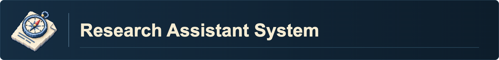
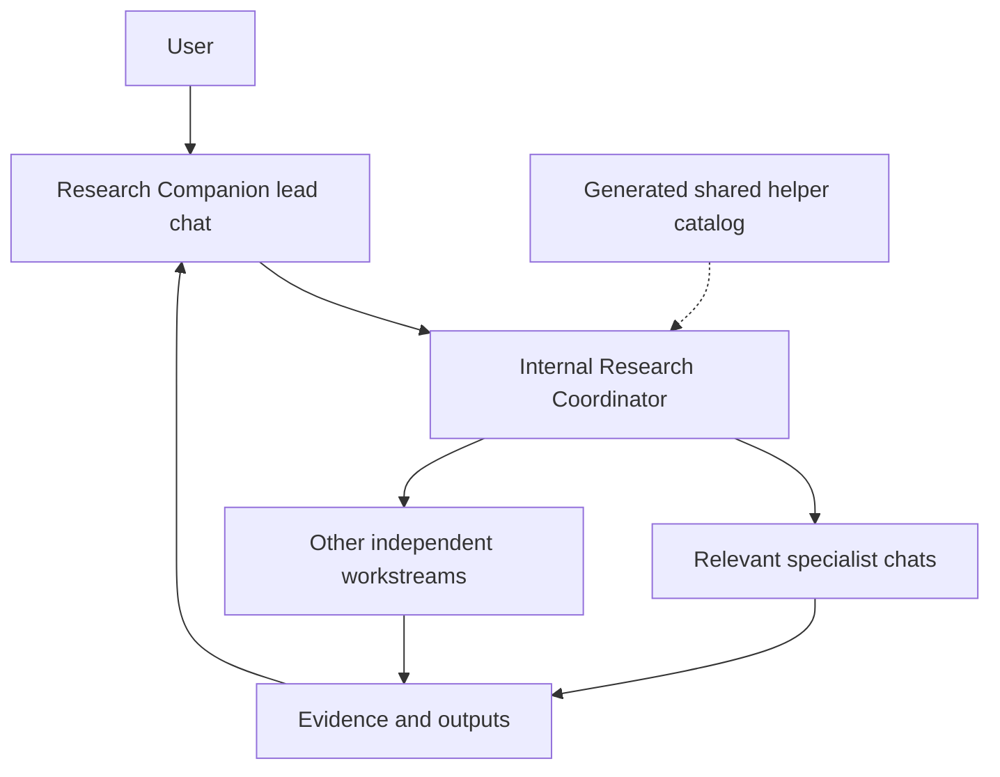

---
related:
created: 2026-07-23
updated: 2026-11-01
---

# Research Assistant System

The Research Assistant System coordinates scientific questions, evidence, methods, analysis and research communication across the recipient's chosen fields.

This note is the human-facing explanation of the system. Agents do not need it: the agent-facing contract (human-control rules, companions and coordination, the part table, routing principles, scientific standards) lives in `00 ASTORIA/skills/research-coordinator/references/research_contract.md`, and each part's routing rules and skill catalog live in that part's coordinator skill. Each active skill follows the Agent Skills folder standard at `00 ASTORIA/skills/<name>/SKILL.md`.

*The Companion owns the project conversation and synthesis. The Coordinator
selects work by each workstream's current stage, reuses or dispatches relevant
workers and collects evidence. Five inquiry parts are catalogs, not five
mandatory agents or sequential project stages.*

## Completion status

The Research Assistant System provides companion-led scientific research support, internal coordination, and bounded routes to verified capabilities. New or revised capabilities proceed one at a time through skill-builder and preserve canonical ownership, narrow loading, scientific control, and verification. Implemented routes do not authorize automatic part progression, skill-family loading, search, execution, saving, external action, or scientific decisions.

## Human-control contract

The user owns scientific choices. Capabilities make concrete, labeled proposals from available evidence and constraints, ask about material gaps, and implement the user's supplied or adopted choices. Exact adoption by reference counts without retyping. A coordinator finds and loads a capability; it does not decide the science. Current authorization carries across requested bounded routes; existing action requirements remain. Missing choices pause only affected work. The full contract, including session ownership and startup rules, is in `00 ASTORIA/skills/research-coordinator/references/research_contract.md`.

## Companions and coordination

[research-companion](../skills/research-companion/SKILL.md) is the research
project entrypoint. Its internal [research-coordinator](../skills/research-coordinator/SKILL.md)
owns capability discovery, concrete assignments, project binding, chat reuse and
collection. Dedicated chats in the verified current Codex project are the
recommended specialist route. One scoped creation choice is enough when launch
and follow-ups are not already authorized; internal skill-loaded workers are the
fallback. A single specialist is valid, and relevant existing chats are reused.

The lead loads the companion and coordinator. Assigned workers load their own
complete skills, required method/software guides and relevant project sources,
without repeating the parent stack. They receive exact questions, scientific
frame/version, current decisions, owned outputs, dependencies and completion
evidence. A queued assignment is not a completed result. After context loss,
each role restores only its current instructions and needed source context.

A project can have dataset documentation, model review and manuscript drafting active
at once. Several workers can share a skill with disjoint scopes. Parallel
writers return section drafts to one canonical manuscript integrator; literature
workers can resolve specific gaps without restarting earlier inquiry. Continue
independent work when only a dependent claim or input is missing. Requested chat
drafts need no extra drafting approval; saving and execution retain their own
requirements. Keep settled scientific choices unless the user changes them or
materially conflicting evidence requires resolution.

Fixed prefixes and project-wide numbering live only in
`00 ASTORIA/skills/research-coordinator/references/team_naming.md`. The generated
Capture and Writing Helpers group in [Skill Map](../Skill%20Map.md) is the shared helper catalog:
curated protocols, progress capture and other support remain distinct workflows
with one canonical skill each. Existing MOC AI Notes hold only useful authorized
team/technical continuity; no separate team tracker or copied catalog is needed.

[PhD and Career System](PhD%20and%20Career%20System.md) owns career and mentoring support through PhD
Companion and its own internal Coordinator, and can request bounded research support.
[research-cv-builder](../skills/research-cv-builder/SKILL.md) remains the
canonical career-document owner; [mindmap](../skills/mindmap/SKILL.md) can
supply bounded visual organization. Cross-system handoffs preserve scope and the
user's chosen return owner.

## Shared writing assistance

Writing Companion and its internal Writing Coordinator live in the shared helper
catalog. Research Companion keeps scientific framing and the user conversation,
while the writing team handles argument development, section drafting and separate
citation, substance, argument-reasoning, structure and integration work. Use as many distinct
roles as the task needs; a roster is not capped at five and is not launched in full
for every request.

Every writing assignment carries the central argument and its provisional or
adopted status, section purpose, selected structure, source locations and the
project's writing guidance. Methods translation uses actual records from the
existing analysis/modality/software specialists, then returns to those owners for
technical fidelity review. Successful processing, inspected images and accepted QC
remain separate claims. One integrator owns the canonical document; independent
reviewers inspect a stable draft. The detailed handoff lives in
`00 ASTORIA/skills/writing-coordinator/references/cross_system_handoff.md`.

Part 5's research-output-coordinator routes publication planning, output/provenance
verification, computational reproduction, release preparation and verification,
engagement, and project closeout. Its ten bounded output skills borrow shared
writers, reporting reviewers and existing technical owners; the existing Grant
Advisor retains application-specific requirements. Select the service needed for
the current output rather than launching every role or imposing a fixed sequence.

Each requirement-dependent service reads the
[current primary-source contract](../skills/research-output-coordinator/references/source_verification.md).
The [repository reference](../skills/research-output-coordinator/references/repositories.md)
is a dated discovery aid that must be checked against current owner policies.
Preparation, successful execution, reproduced findings, deposited records and
public release remain distinct states. Research Companion retains scientific
framing and the original session owner receives the service result.

## Five parts of scientific inquiry (1 to 5)

The parts are numbered, not ordered: a project moves between them as the work requires. Each part has one coordinator skill. The coordinator's `SKILL.md` carries the part's routing rules and a catalog of its skills that `skills-janitor/scripts/build_views.py` generates from the skills' frontmatter (`part`, `family`, `modality`, `population`). For each assignment, the lead consults the relevant catalog or verifies an exact named capability, then the selected worker reads and performs its skill. Dependencies and method/modality requirements still apply; evidence returns to the companion.

| Part | User function | Coordinator |
|---|---|---|
| 1. Help me scout the field | Observe and Situate | [scout-coordinator](../skills/scout-coordinator/SKILL.md) |
| 2. Help me challenge my question | Question and Scope | [challenge-coordinator](../skills/challenge-coordinator/SKILL.md) |
| 3. Help me stress-test my hypothesis and design | Hypothesize and Design | [stress-test-coordinator](../skills/stress-test-coordinator/SKILL.md) |
| 4. Help me analyze the data | Process, Analyze, and Reason | [analysis-coordinator](../skills/analysis-coordinator/SKILL.md) |
| 5. Help me finish, share, and publish research | Finish, Verify, Share, Publish, and Preserve | [research-output-coordinator](../skills/research-output-coordinator/SKILL.md) |

Part 1 includes [first-principles-research](../skills/first-principles-research/SKILL.md)
for exploring research through primitives, constraints, equations, and algorithms.
Its five modes are **Explore a question**, **Deconstruct a study**, **Scout unresolved questions**,
**Transfer a method**, and **Build a minimal model**. It recommends a mode at the
start, begins within the request, and lets the user switch in ordinary language.
Research Companion retains session ownership when it invokes this capability.
General heuristic brainstorming stays in Part 2; exploratory mathematical models
remain distinct from adopted hypotheses and finalized designs.

Part 4 adds a second routing hop for neuroimaging: the modality coordinators (fmri-coordinator, smri-coordinator, dwi-coordinator, eeg-coordinator, asl-coordinator, meg-coordinator, pet-coordinator) return one checkpointed route before an adapter runs. Method guides produce specifications; software and model adapters execute one approved operation each. The writing profiles (`writing-style-positive-scientific`, `writing-style-negative-ai`) are rule-only references. Apply each independently only when selected for the task or in the recipient's preferences.

The full list of skills with their part, family, modality, and triggers is the Base view in `00 ASTORIA/Skills.md`, and the coordinators' catalogs.

## Scientific standards

- Prefer primary empirical sources for research claims.
- Never invent citations, methods, results, parameters, defaults, file paths, or project facts.
- Report exact p-values, effect estimates, confidence intervals, assumptions, and uncertainty when available and relevant.
- Nonsignificance does not establish the null.
- Evidence for absence requires a justified method such as equivalence testing with a smallest effect size of interest or an appropriate Bayesian analysis.
- Record and report outcome-dependent choices and deviations honestly.
- Methods and available software must not determine the scientific question.

## References

- Broad Research Communication Lab. (n.d.). *Journal article: Discussion*. https://mitcommlab.mit.edu/broad/commkit/journal-article-discussion/
- Cornell Engineering Communications Program. (n.d.). *Toulmin model of argument*. https://courses.cit.cornell.edu/engrwords/handouts/Culver_Hu_Rubin_Tundo_TMI_Handout.pdf
- Duke Nicholas School Communications Studio. (n.d.). *Scientific journal articles*. https://sites.nicholas.duke.edu/studio/communications-resources/genres/scientific-articles/
- Duke Thompson Writing Program. (n.d.). *Paragraphing: The MEAL plan*. https://twp.duke.edu/sites/twp.duke.edu/files/file-attachments/hs_meal_plan.pdf
- Harvard College Writing Center. (n.d.-a). *Anatomy of a body paragraph*. https://writingcenter.fas.harvard.edu/anatomy-body-paragraph
- Harvard College Writing Center. (n.d.-b). *Asking analytical questions*. https://writingcenter.fas.harvard.edu/asking-analytical-questions
- Harvard College Writing Center. (n.d.-c). *Counterargument*. https://writingcenter.fas.harvard.edu/counterargument
- Harvard Law School Institute for Global Law and Policy. (n.d.). *The IGLP approaches*. https://iglp.law.harvard.edu/the-iglp-approaches/
- MIT AeroAstro Communication Lab. (n.d.). *Formalizing a research topic*. https://mitcommlab.mit.edu/aeroastro/commkit/formalizing-a-research-topic/
- MIT NSE Communication Lab. (n.d.). *Journal article: Introduction*. https://mitcommlab.mit.edu/nse/commkit/journal-article-introduction/
- Oxford Centre for Evidence-Based Medicine. (n.d.). *Critical appraisal tools*. https://www.cebm.ox.ac.uk/resources/ebm-tools/critical-appraisal-tools
- Stanford CS197. (n.d.). *Vectoring in research*. https://web.stanford.edu/class/archive/cs/cs197.1232/slides/04-vectoring.pdf
- Stanford CS197C. (n.d.). *Project proposal*. https://web.stanford.edu/class/cs197c/assignments/project.html
- Stanford University. (n.d.). *The structure of a scientific report*. https://stanford.edu/class/ee267/WIM/writing_report_structure.pdf
- Yale Poorvu Center for Teaching and Learning. (n.d.). *Elements of the academic paper*. https://poorvucenter.yale.edu/writing/writing-resources-for-graduate-students/elements-of-the-academic-paper
