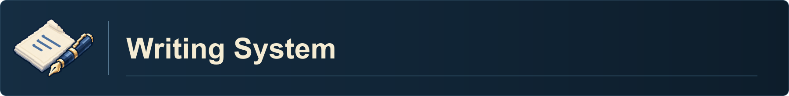

---
related:
  - "[[Skill Map]]"
created: 2026-11-18
updated: 2026-11-18
---

# Writing System

Writing Companion heads this system. It helps develop documents and selects the right capability for writing, review, capture, preparation and style work. Its internal Writing Coordinator organizes dependent writing assignments and collects their results.

A clear bounded request goes directly to its specialist. A spelling correction needs the supplied text. A Methods revision needs its passage and supporting records. Developing a manuscript across sections uses the coordinated writing workflow, including relevant independent reviews and one integration editor.

## Find the right capability

| Requested result | Capability |
| --- | --- |
| Develop a document across sections or coordinate writing work | [Writing Companion](../skills/writing-companion/SKILL.md) and its internal [Writing Coordinator](../skills/writing-coordinator/SKILL.md) |
| Draft or review one bounded writing object | Its specialist in [the generated Writing System catalog](../Skill%20Map.md#-writing-system) |
| File supplied notes, from a single decision to a full meeting record | [Quick Capture](../specialized_skills/quick-capture/SKILL.md) |
| Summarize a conversation or preserve an exact transcript | [Summarize](../specialized_skills/summarize/SKILL.md), using the requested summary, transcript and save choices |
| Prepare context for a named AI chat or review its return | [Chat Handoff](../specialized_skills/chat-handoff/SKILL.md) |
| Produce a redaction candidate for review | [Redactor](../specialized_skills/redactor/SKILL.md) |
| Curate an established procedure into a reviewed protocol | [Write Protocol](../specialized_skills/write-protocol/SKILL.md) |
| Build or update a passive style reference from supplied sources | [Writing Style Builder](../specialized_skills/writing-style-builder/SKILL.md) |

The requested result determines the route. “Capture the argument in this Introduction” asks for writing. “Capture this session in the project log” asks for a saved record. A quoted trigger is part of the supplied material. Paper summaries belong to [Research Summarizer](../skills/research-summarizer/SKILL.md), and course-policy replies belong to [Teaching Office Hours](../specialized_skills/teaching-office-hours/SKILL.md).

## Writing and review

Use the current purpose, audience, passage and supporting sources. Bring in project context and recipient-supplied writing guidance when they bear on substantive writing or argument review. Provisional claims can support outlines and appropriately qualified prose while their owner resolves consequential decisions.

Staff the work around its actual needs. Reuse existing technical specialists and consult them for concrete missing facts or decisions. Citation support, substance, structure and argument reasoning are distinct review questions. Use named paragraph frameworks and their reviewers only when selected for the task or recorded in the recipient's preferences. Keep one editor for a canonical document and recheck the passages affected by a repair.

When another companion is already leading, it remains the session and domain owner. Shared writing returns to that caller with the requested text and relevant findings.

## Capture, summaries and saved records

A clear request to capture, log or jot down a record authorizes saving when its source and owner are known. Drafts and proposed entries follow the current request's deliverable form, then the recipient's applicable verified reporting policy, with chat as the fallback. Honor explicit current chat-only or no-save instructions. Required preview artifacts stay within their authorized task scope; their format grants no capture-record, index-edit or external-send authority. Summaries and transcripts are separate choices, and a transcript is included when requested. Exact-text requests preserve their supplied wording.

Project captures use the owning MOC's Research Log. Meeting and area captures use their established notes. With Calendar indexing selected, keep one daily index record per external original with a verified note-relative Markdown link to its exact populated heading. Retain working links and labels. Add transclusion only when selected by the recipient and supported by the receiving app, retaining the plain link in the same record. General captures can be written directly in that log. On retry, preserve the saved original and repair only missing or broken index references using the original capture date. Requested human protocols retain their reviewed content and placement. Agent continuity follows the recipient's verified location and applicable MOC policy.

For a combined request, complete dependent work in order. When someone asks to summarize and log a meeting, Summarize prepares the requested text and Quick Capture files it once. Each output follows its own source, profile and saving requirements.

## Writing style

[Positive Scientific](../skills/writing-style-positive-scientific/SKILL.md) and [Negative AI](../skills/writing-style-negative-ai/SKILL.md) are passive references. The active writing capability applies them according to `me.md`. Profile creation has its own bounded test cycle, and newly created profiles join this system's Writing style section.

Profile activation follows the specific output. Formal scientific prose uses the configured profiles. A requested style edit of a derived summary can use an explicitly named profile. Exact transcripts, captured source text and verified records retain their fidelity requirements.
